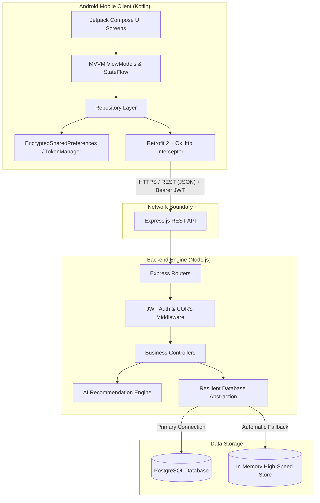
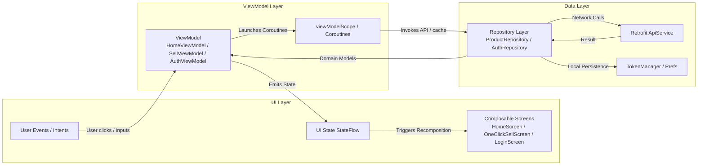
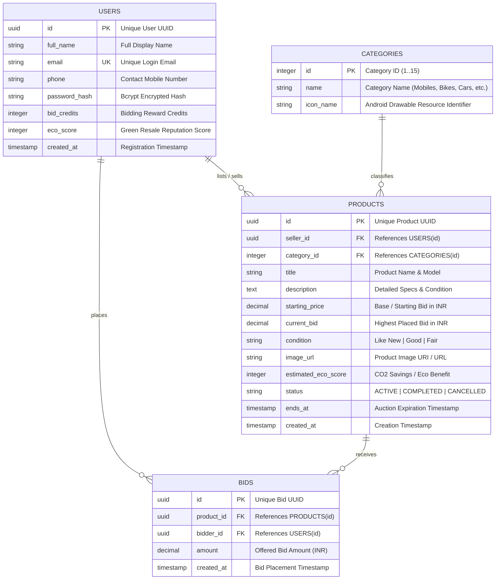
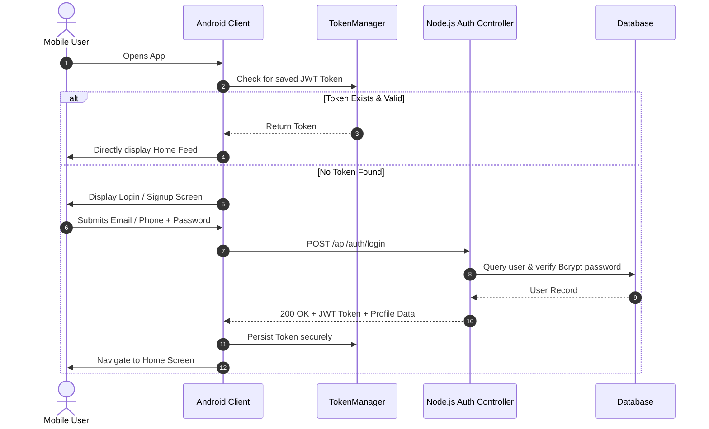
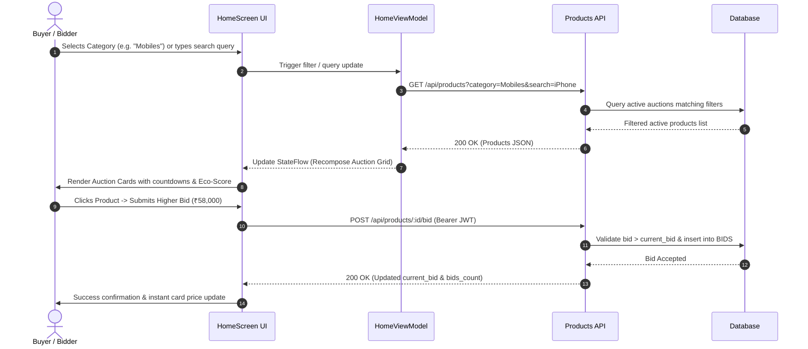
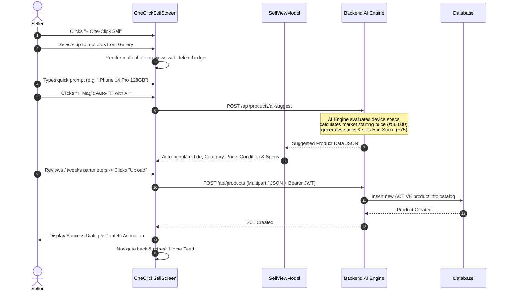

# 🚀 Bid.ai - AI-Powered Smart Selling & Live Auction Platform

[](https://kotlinlang.org)
[](https://developer.android.com/jetpack/compose)
[](https://developer.android.com/topic/architecture)
[](https://nodejs.org)
[](https://www.postgresql.org)
[](https://m3.material.io)

> **Bid.ai** is a full-stack mobile auction and re-commerce ecosystem engineered for ultra-fast, intelligent selling. Featuring pixel-perfect Figma screens, an MVVM Android architecture with Jetpack Compose, an Express + PostgreSQL backend, and an AI-driven **One-Click Sell** workflow.

---

## 📑 Table of Contents
1. [System Architecture](#-system-architecture)
2. [Android MVVM Architecture](#-android-mvvm-architecture)
3. [Database Schema & ER Diagram](#-database-schema--er-diagram)
4. [End-to-End Application Workflows](#-end-to-end-application-workflows)
   - [Workflow 1: Authentication & JWT Session](#1-authentication--session-lifecycle-workflow)
   - [Workflow 2: Live Auction Discovery & Bidding](#2-live-auction-discovery--bidding-workflow)
   - [Workflow 3: One-Click Sell & AI Auto-Fill](#3-one-click-sell--ai-auto-fill-workflow)
5. [Key Features & Highlights](#-key-features--highlights)
6. [Repository Structure](#-repository-structure)
7. [REST API Documentation](#-rest-api-documentation)
8. [Getting Started & Local Setup](#-getting-started--local-setup)
   - [Backend API Setup](#1-backend-api-setup)
   - [Android App Setup](#2-android-app-setup)
9. [Credentials & Testing Guide](#-credentials--testing-guide)

---

## 🏛️ System Architecture

Bid.ai is structured with a decoupled client-server architecture:



---

## 📱 Android MVVM Architecture

The mobile application strictly adheres to the official Android Architecture Guidelines with uni-directional data flow (UDF):



- **Declarative UI:** Jetpack Compose with Material 3 tokens, custom royal blue curved headers (`#0B3B95`), dynamic category filters, and smooth state animations.
- **State Management:** Reactive `StateFlow` and `SharedFlow` for lifecycle-aware state consumption (`collectAsStateWithLifecycle`).
- **Network Resilience:** OkHttp client configured with automatic JWT authorization header injection and custom logging.
- **Image Pipeline:** Async image decoding, caching, and placeholder fallback with Coil.

---

## 🗄️ Database Schema & ER Diagram



---

## 🔄 End-to-End Application Workflows

### 1. Authentication & Session Lifecycle Workflow



---

### 2. Live Auction Discovery & Bidding Workflow



---

### 3. One-Click Sell & AI Auto-Fill Workflow



---

## ✨ Key Features & Highlights

- **15 Native Category Filters:** Integrated with high-resolution vector assets:
  - *Mobiles, Electronics, Cars, Bikes, Clothing, Home & Garden, Books, Beauty, Art & Craft, Real Estate, Services, Jobs, Agriculture, General Science, and Yodha Special.*
- **Multi-Image Upload & Preview:** Pick multiple images from device storage with live carousel preview and instant removal capability.
- **AI-Powered Product Estimation:** Dynamic market valuation and automated description generation for quick listings.
- **Eco-Score & Circular Economy:** Every pre-owned transaction computes environmental score points, promoting sustainable commerce.
- **Resilient Offline / Memory Mode:** The backend automatically falls back to an internal data store if cloud PostgreSQL is unreachable, guaranteeing 100% demo uptime.

---

## 📂 Repository Structure

```
BID.ai/
├── android/                               # Native Android Kotlin Project
│   ├── app/
│   │   ├── src/main/java/com/bidai/app/
│   │   │   ├── data/
│   │   │   │   ├── api/                  # Retrofit ApiService & OkHttp Client
│   │   │   │   ├── model/                # Data Classes (User, Product, Bid, Category)
│   │   │   │   └── repository/           # AuthRepository & ProductRepository
│   │   │   ├── ui/
│   │   │   │   ├── components/           # Reusable Compose Widgets (AuctionCard, EcoBadge)
│   │   │   │   ├── navigation/           # Compose Navigation Routes & NavHost
│   │   │   │   ├── screens/              # Core Screen Implementations
│   │   │   │   │   ├── auth/             # Login & Signup Screens
│   │   │   │   │   ├── home/             # Home Auction Feed & Search
│   │   │   │   │   └── sell/             # One-Click Sell & AI Auto-Fill Screen
│   │   │   │   └── theme/                # Royal Blue Theme, Typography & Colors
│   │   │   └── utils/                    # TokenManager & Form Validators
│   │   └── src/main/res/
│   │       └── drawable/                 # 15 Category Icons & Graphic Assets
│   ├── build.gradle.kts
│   └── settings.gradle.kts
│
├── backend/                               # Node.js + Express REST API Server
│   ├── src/
│   │   ├── controllers/                  # authController.js & productsController.js
│   │   ├── db/                           # postgres.js, schema.sql & in-memory fallback
│   │   ├── middleware/                   # JWT verification & Error handlers
│   │   ├── routes/                       # auth.js & products.js
│   │   └── server.js                     # Express App Initialization & Port Binding
│   ├── package.json
│   └── .env
│
├── .gitignore                             # Git ignore rules for Android & Node
└── README.md                              # Complete System Documentation
```

---

## 📡 REST API Documentation

Base URL: `http://localhost:5000/api` (Android Emulator: `http://10.0.2.2:5000/api`)

| Method | Endpoint | Auth | Description | Sample Request / Query |
|---|---|:---:|---|---|
| `GET` | `/health` | No | Health check & server status | `GET /api/health` |
| `POST` | `/auth/register` | No | Register new user account | `{"fullName":"Anshuman","email":"anshu@bid.ai","password":"password123","phone":"+919876543210"}` |
| `POST` | `/auth/login` | No | Authenticate user & get JWT | `{"email":"demo@bid.ai","password":"password123"}` |
| `GET` | `/auth/profile` | **Yes** | Retrieve user profile & credits | Header: `Authorization: Bearer <token>` |
| `GET` | `/products/categories` | No | Fetch all 15 auction categories | `GET /api/products/categories` |
| `GET` | `/products` | No | Live auction feed with filters | `?category=Mobiles&search=iPhone&sort=endingSoon` |
| `GET` | `/products/:id` | No | Get single product + bid history | `GET /api/products/3f4e5a...` |
| `POST` | `/products/ai-suggest` | No | Smart price & spec suggestion | `{"query":"Samsung Galaxy S23 Ultra 256GB"}` |
| `POST` | `/products` | **Yes** | Create new auction listing | `{"title":"iPhone 14 Pro","startingPrice":56000,"categoryId":2,"condition":"Like New"}` |
| `POST` | `/products/:id/bid` | **Yes** | Place a higher bid | `{"amount": 58000}` |

---

## 🚀 Getting Started & Local Setup

### 1. Backend API Setup

**Prerequisites:** Node.js v18+ installed.

```bash
# 1. Navigate to the backend directory
cd backend

# 2. Install dependencies
npm install

# 3. Configure environment variables (optional: default settings work out-of-the-box)
# .env is pre-configured with resilient database options

# 4. Start the server
npm start
```

The server will launch at `http://localhost:5000` with the following output:
```text
🚀 Bid.ai API Server running on port 5000
👉 Local Health Check: http://localhost:5000/api/health
```

---

### 2. Android App Setup

**Prerequisites:** Android Studio Ladybug / Meerkat or newer with Android SDK 34+.

1. Open **Android Studio**.
2. Select **File -> Open...** and select the `BID.ai/android` directory.
3. Wait for Gradle Sync to complete.
4. Run on an **Android Virtual Device (AVD)** (Emulator) or a physical Android device with USB Debugging enabled.
   > **Note on Emulator Networking:** The Android app automatically routes requests to `http://10.0.2.2:5000` when running in the emulator to communicate seamlessly with your local Node.js backend.

To build the debug APK via CLI:
```bash
cd android
./gradlew assembleDebug
```
The compiled APK will be located at:
`android/app/build/outputs/apk/debug/app-debug.apk`

---

## 🔑 Credentials & Testing Guide

For quick evaluation and testing, the application comes with built-in test accounts:

| Role | Email / Identifier | Password | Access Level |
|---|---|---|---|
| **Demo User** | `demo@bid.ai` | `password123` | Full Buyer / Seller Access |
| **Test Admin** | `admin@bid.ai` | `admin123` | Full Access + Elevated Eco Score |

### Quick Smoke Test Checklist:
- [x] **Login:** Login with `demo@bid.ai` / `password123` or register a new account.
- [x] **Feed Discovery:** Browse items, switch between categories, and search keywords like `iPhone` or `MacBook`.
- [x] **Bidding:** Open any active auction card and place a bid higher than the current price.
- [x] **AI Auto-Fill:** Navigate to the **One-Click Sell** tab, select photos, click **Magic Auto-Fill with AI**, and upload your product to watch it appear immediately on the Home screen.

---

## 📄 License & Assessment Note
This codebase is developed as part of the technical evaluation for **Bid.ai**. All rights reserved.
