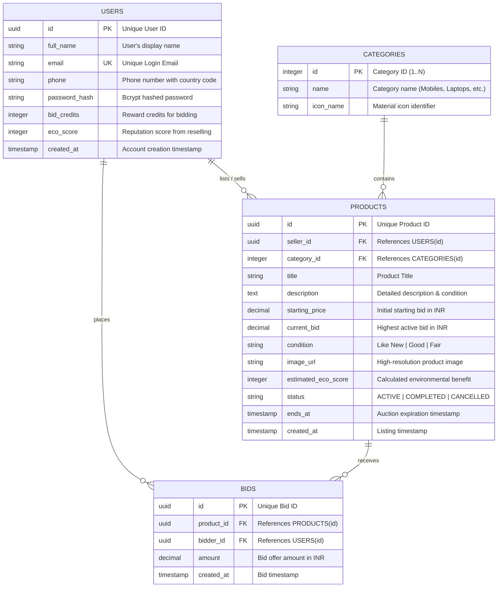
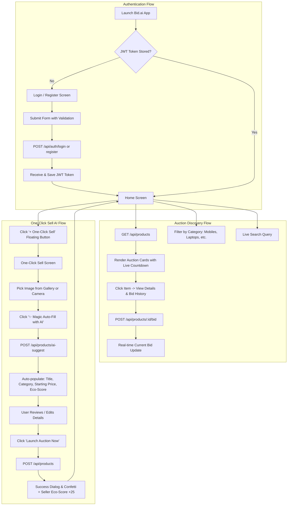

# 📑 Bid.ai - Technical Documentation & Architecture

This document provides a concise and comprehensive technical overview of the **Bid.ai** Mobile App (Android Kotlin) and Backend (Node.js + PostgreSQL).

---

## 🛠️ 1. Tech Stack Used

### 📱 Android Mobile Client
- **Language:** Kotlin 2.0+
- **UI Toolkit:** Jetpack Compose + Material 3 Design System
- **Architecture Pattern:** MVVM (Model-View-ViewModel) + Repository Pattern
- **Reactive State Management:** Kotlin Coroutines + `StateFlow` / `SharedFlow`
- **Networking:** Retrofit 2 + OkHttp3 with JWT Authorization Interceptor
- **JSON Serialization:** Google Gson / Kotlinx Serialization
- **Image Pipeline:** Coil (Coroutine Image Loader) with memory & disk caching
- **Local Persistence:** EncryptedSharedPreferences / Jetpack DataStore

### 💻 Backend API Engine
- **Runtime:** Node.js v24+
- **Web Framework:** Express.js 4.x
- **Database:** PostgreSQL (Cloud Neon.tech or Local PG) with resilient In-Memory Driver
- **Authentication:** JWT (JSON Web Tokens) with 7-day expiration + Bcrypt password hashing
- **Security & Headers:** CORS, parameter sanitization, and structured error boundaries

---

## 🗄️ 2. Entity-Relationship (ER) Diagram

---

## 🔄 3. Flow Diagram (User Journey & Architecture Flow)

---

## 📡 4. REST API Endpoints Table

| Method | Endpoint | Access | Description | Sample Payload / Response |
|---|---|---|---|---|
| `GET` | `/api/health` | Public | Server uptime & status | `{"status":"healthy","uptime":...}` |
| `POST` | `/api/auth/register` | Public | Create new user account | `{"fullName":"..","email":"..","password":".."}` |
| `POST` | `/api/auth/login` | Public | Authenticate user & get JWT | `{"email":"..","password":".."}` |
| `GET` | `/api/auth/profile` | Bearer Token | Fetch user's credits & eco score | `{"data":{"fullName":"..","bidCredits":100}}` |
| `GET` | `/api/products/categories` | Public | Fetch all available categories | `[{"id":2,"name":"Mobiles"}]` |
| `GET` | `/api/products` | Public | Live auctions with search/filters | `?category=Mobiles&search=iPhone` |
| `GET` | `/api/products/:id` | Public | Full product details + bids | `{"data":{ "title":"..", "bids":[..] }}` |
| `POST` | `/api/products` | Bearer Token | List product ("One-Click Sell") | `{"title":"..","startingPrice":45000}` |
| `POST` | `/api/products/:id/bid` | Bearer Token | Submit higher bid for auction | `{"amount": 48000}` |
| `POST` | `/api/products/ai-suggest` | Public | Auto-fill smart price & details | `{"query":"iPhone 14"}` |

---

## 🧪 5. Testing with Postman

1. Open Postman.
2. Click **Import** and select `docs/BidAI_Postman_Collection.json`.
3. Set the `baseUrl` variable to `http://localhost:5000` (or `http://10.0.2.2:5000` if testing from Android Emulator).
4. Run the requests in order. The **Auth - Login** request automatically stores the returned JWT token into the collection's `authToken` variable!
